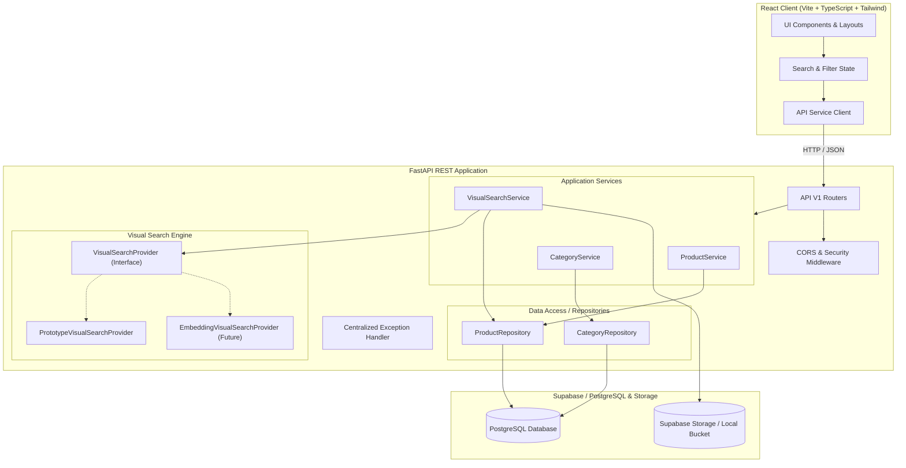
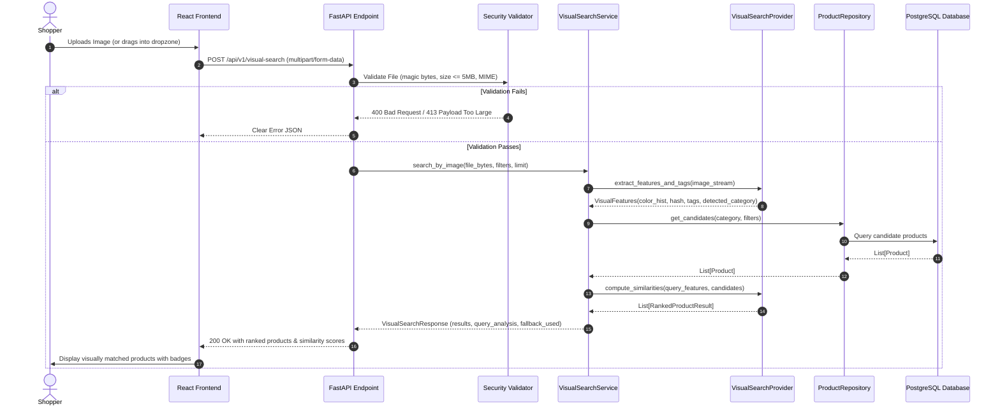
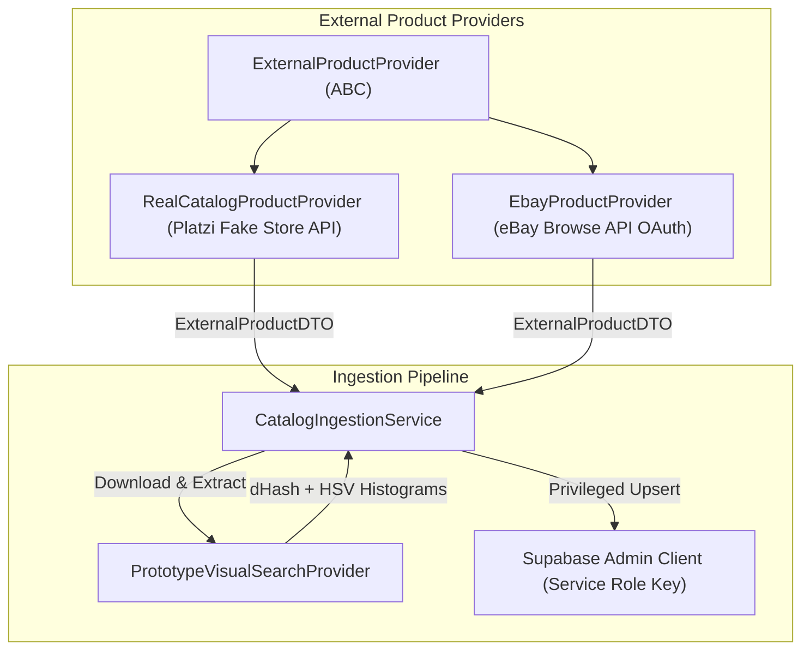

# SYSTEM ARCHITECTURE

```text
STATUS: IMPLEMENTATION SPECIFICATION
Phase: First-Round Prototype
Target: Scalable Full-Stack Architecture
```

---

## 1. High-Level System Architecture

The Visual Product Finder follows a layered, decoupled architecture with strict separation between presentation, application orchestration, domain business logic, data access, and storage.



---

## 2. Visual Search Pipeline Architecture

The visual search subsystem is strictly isolated behind a provider interface. The frontend and API endpoints never know or care which provider is running.



---

## 3. Component Breakdown

### Frontend (`/frontend`)
- **`pages/`**:
  - `LandingPage.tsx`: Consumer entry with Hero, Discovery Methods, Visual Search Showcase, How It Works, Categories, Featured Products, Trust, and Final CTA.
  - `DiscoverPage.tsx`: Full catalog with search, department pills, left sidebar/mobile drawer filters, responsive product grid.
  - `SearchResultsPage.tsx`: Dedicated search route (`/search?q=...`) with persistent URL state.
  - `VisualSearchPage.tsx`: Dedicated visual search workflow (`EMPTY`, `PROCESSING`, `RESULTS`, `ERROR` states) with live query analysis.
  - `CategoriesPage.tsx` & `CategoryDetailPage.tsx`: Department taxonomy navigation and department-filtered catalog.
  - `ProductDetailPage.tsx`: 4:5 image gallery, extracted palette, specs table, and Visually Similar Products shelf.
- **`components/common`**: Reusable design tokens (`Navbar`, `Footer`, `ScrollToTop`, `Skeleton`, `EmptyState`).
- **`components/landing`**: Editorial section components (`HeroSection`, `DiscoveryMethodsSection`, `VisualSearchShowcaseSection`, `HowItWorksSection`, `CategoryDiscoverySection`, `FeaturedProductsSection`, `TrustSection`, `FinalCtaSection`).
- **`components/search`**: `FilterSidebar` (categories, price range slider, brands, tags), `ActiveFilters` bar with mobile filter trigger.
- **`components/product`**: `ProductGrid`, `ProductCard`, `SimilarProducts`.
- **`services/api`**: Type-safe REST client for products, categories, facets, and visual search.

### Backend (`/backend`)
- **`app/api/v1/endpoints`**: Thin route handlers that validate input via Pydantic schemas and delegate to service layer.
- **`app/services`**:
  - `ProductService`: Business rules for filtering, catalog paging, detail views, and facet calculations.
  - `VisualSearchService`: Orchestrates image validation, feature extraction via provider, candidate retrieval, ranking, and graceful fallback.
- **`app/services/vision_providers`**:
  - `base.py`: `VisualSearchProvider` abstract base class defining `extract_features(image_bytes)` and `calculate_similarity(query_feat, target_feat)`.
  - `prototype_provider.py`: Mathematical feature extraction using PIL and NumPy (dominant color palette in HSV space, 64-bit perceptual hash, aspect ratio, edge density, and tag semantic matching).
  - `embedding_provider.py`: Scaffold for CLIP/OpenCLIP / pgvector embeddings for future transition.
- **`app/repositories`**: Encapsulates all database queries to Supabase PostgreSQL, insulating services from SQL/ORM specifics.
- **`app/core`**: Configuration (`pydantic-settings`), custom exceptions, security validators (magic byte inspection), structured logging.

---

## 4. Architectural Rules & Invariants
1. **No Hard-Coded Business Logic**: Never match based on image filename or mock switches (`if file == "shoe.jpg"`). All visual matching computes genuine mathematical similarity over extracted image attributes.
2. **Resilient Fallback**: If visual feature extraction yields low confidence or no matches within similarity threshold, the system gracefully falls back to relevant category/popular products, clearly flagging `fallback_used: true` to the UI.
3. **Database Single Source of Truth**: All product data, prices, tags, stock, and descriptions are stored in PostgreSQL.
4. **Zero Frontend Business Logic**: The frontend is purely presentational and interactional. Filtering logic, candidate scoring, and similarity thresholds are computed on the backend.
5. **Multi-Device Responsive Standard**: Full viewport spanning (`100vw`) with zero horizontal overflow, 4-column desktop, 3-column tablet, 2-column mobile product grids, and 1-tap mobile filter drawer.

---

## 5. External Product Data Providers & Ingestion Pipeline

To ensure the application operates on verified, scalable external catalog data rather than static seed files, the system incorporates an extensible product provider subsystem:



### 5.1 Provider Verification & Provenance
1. **Real Online Catalog Provider (`real_catalog_provider.py` - Option B):**
   - **External Provider:** Platzi Fake Store API
   - **Official Endpoint:** `https://api.escuelajs.co/api/v1/products`
   - **Authentication:** None required (Public open REST endpoint)
   - **Data Retrieved:** Live product items with titles, descriptions, prices, categories, and image URLs.
   - **Image Source:** Remote photography hosted on Cloudinary and Imgur CDNs.
   - **Import Method:** HTTP GET via asynchronous `httpx.AsyncClient` with custom User-Agent.
   - **Rate Limit:** Open API fair use (~100 req/min).
   - **Current Status:** Verified and active. 30 products successfully ingested into Supabase.

2. **eBay Browse API Provider (`ebay_provider.py` - Option A):**
   - **External Provider:** eBay Developer Program (Browse API v1)
   - **Official Endpoints:**
     - Auth: `https://api.ebay.com/identity/v1/oauth2/token` (or sandbox)
     - Search: `https://api.ebay.com/buy/browse/v1/item_summary/search`
   - **Authentication:** OAuth 2.0 Client Credentials Grant (`grant_type=client_credentials`, Basic Auth).
   - **Token Management:** In-memory caching with automatic refresh when remaining validity is under 60 seconds.
   - **Rate Limits & Errors:** Handles HTTP 429 rate limits, HTTP 401 token invalidation, and raises explicit configuration requirements if credentials are absent.
   - **Current Status:** Staged and verified in unit tests. Requires `EBAY_CLIENT_ID` and `EBAY_CLIENT_SECRET` in `backend/.env`.

