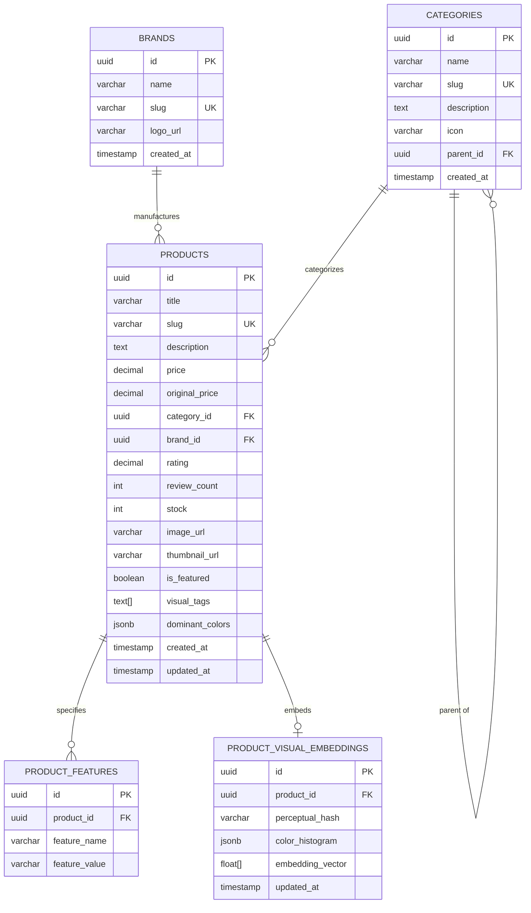

# DATABASE & STORAGE SPECIFICATION

```text
STATUS: SPECIFIED & MIGRATION READY
Target Database: Supabase PostgreSQL
Schema Version: 001_initial_schema
```

---

## 1. Schema Overview

The database design provides a 3NF normalized structure for core catalog entities, combined with JSONB/array attributes for high-performance visual metadata, facet queries, and future vector index integration (`pgvector`).



---

## 2. Table Definitions & Constraints

### 2.1 `categories`
| Column | Type | Constraints | Description |
|---|---|---|---|
| `id` | `UUID` | `PRIMARY KEY DEFAULT gen_random_uuid()` | Unique category identifier |
| `name` | `VARCHAR(100)` | `NOT NULL` | Human-readable name |
| `slug` | `VARCHAR(120)` | `UNIQUE NOT NULL` | URL-safe slug |
| `description` | `TEXT` | `NULL` | Category summary |
| `icon` | `VARCHAR(50)` | `NULL` | Icon identifier (e.g. Lucide name) |
| `parent_id` | `UUID` | `REFERENCES categories(id) ON DELETE SET NULL` | Parent category for hierarchy |
| `created_at` | `TIMESTAMPTZ` | `DEFAULT NOW()` | Record creation timestamp |

### 2.2 `brands`
| Column | Type | Constraints | Description |
|---|---|---|---|
| `id` | `UUID` | `PRIMARY KEY DEFAULT gen_random_uuid()` | Unique brand identifier |
| `name` | `VARCHAR(100)` | `NOT NULL` | Brand name |
| `slug` | `VARCHAR(120)` | `UNIQUE NOT NULL` | URL-safe brand slug |
| `logo_url` | `VARCHAR(500)` | `NULL` | Brand logo image link |
| `created_at` | `TIMESTAMPTZ` | `DEFAULT NOW()` | Record creation timestamp |

### 2.3 `products`
| Column | Type | Constraints | Description |
|---|---|---|---|
| `id` | `UUID` | `PRIMARY KEY DEFAULT gen_random_uuid()` | Unique product identifier |
| `title` | `VARCHAR(255)` | `NOT NULL` | Product name / title |
| `slug` | `VARCHAR(280)` | `UNIQUE NOT NULL` | URL-friendly product slug |
| `description` | `TEXT` | `NOT NULL` | Detailed product copy |
| `price` | `NUMERIC(10, 2)` | `NOT NULL CHECK (price >= 0)` | Current selling price |
| `original_price` | `NUMERIC(10, 2)` | `CHECK (original_price >= price)` | Strikethrough comparison price |
| `category_id` | `UUID` | `NOT NULL REFERENCES categories(id) ON DELETE RESTRICT` | Primary category |
| `brand_id` | `UUID` | `NOT NULL REFERENCES brands(id) ON DELETE RESTRICT` | Associated brand |
| `rating` | `NUMERIC(3, 2)` | `DEFAULT 0.0 CHECK (rating >= 0 AND rating <= 5)` | Average rating |
| `review_count` | `INT` | `DEFAULT 0 CHECK (review_count >= 0)` | Total customer reviews |
| `stock` | `INT` | `DEFAULT 0 CHECK (stock >= 0)` | Available units |
| `image_url` | `VARCHAR(1000)` | `NOT NULL` | High-res product image URL |
| `thumbnail_url` | `VARCHAR(1000)` | `NULL` | Optimized thumbnail URL |
| `is_featured` | `BOOLEAN` | `DEFAULT FALSE` | Highlight in featured carousels |
| `visual_tags` | `TEXT[]` | `DEFAULT '{}'` | Extracted tags (e.g. 'sneakers', 'leather', 'black') |
| `dominant_colors`| `JSONB` | `DEFAULT '[]'::jsonb` | Extracted palette (e.g. `[{"hex":"#000000","ratio":0.6}]`)|
| `created_at` | `TIMESTAMPTZ` | `DEFAULT NOW()` | Record creation timestamp |
| `updated_at` | `TIMESTAMPTZ` | `DEFAULT NOW()` | Last update timestamp |

### 2.4 `product_features`
| Column | Type | Constraints | Description |
|---|---|---|---|
| `id` | `UUID` | `PRIMARY KEY DEFAULT gen_random_uuid()` | Identifier |
| `product_id` | `UUID` | `NOT NULL REFERENCES products(id) ON DELETE CASCADE` | Product relationship |
| `feature_name` | `VARCHAR(100)` | `NOT NULL` | Spec name (e.g. "Battery Life", "Material") |
| `feature_value`| `VARCHAR(255)` | `NOT NULL` | Spec value (e.g. "30 Hours", "Anodized Aluminum") |

### 2.5 `product_visual_embeddings`
| Column | Type | Constraints | Description |
|---|---|---|---|
| `id` | `UUID` | `PRIMARY KEY DEFAULT gen_random_uuid()` | Identifier |
| `product_id` | `UUID` | `UNIQUE NOT NULL REFERENCES products(id) ON DELETE CASCADE` | 1-to-1 with Product |
| `perceptual_hash` | `VARCHAR(64)` | `NOT NULL` | dHash / aHash 64-bit string |
| `color_histogram` | `JSONB` | `NOT NULL` | Normalized 32-bin HSV color histogram |
| `embedding_vector` | `FLOAT[]` | `NULL` | 512-dim / 768-dim CLIP vector for pgvector |
| `updated_at` | `TIMESTAMPTZ` | `DEFAULT NOW()` | Extraction timestamp |

---

## 3. Database Indexes
```sql
-- Full text and keyword search
CREATE INDEX idx_products_title_desc ON products USING gin(to_tsvector('english', title || ' ' || description));

-- Filter facets
CREATE INDEX idx_products_category ON products(category_id);
CREATE INDEX idx_products_brand ON products(brand_id);
CREATE INDEX idx_products_price ON products(price);
CREATE INDEX idx_products_rating ON products(rating DESC);
CREATE INDEX idx_products_visual_tags ON products USING gin(visual_tags);

-- Features indexing
CREATE INDEX idx_product_features_prod ON product_features(product_id);
CREATE INDEX idx_product_features_name_val ON product_features(feature_name, feature_value);
```

---

## 4. Row Level Security (RLS)
- `products`, `categories`, `brands`, `product_features`:
  - `SELECT`: Allowed for `anon` and `authenticated` roles (public storefront read).
  - `INSERT / UPDATE / DELETE`: Restricted to `service_role` (backend administrative write).
- `product_visual_embeddings`:
  - `SELECT`: Service role and authenticated read.

---

## 5. Supabase Storage Buckets
1. **`product-catalog-images`**:
   - Access: Public Read
   - Max file size: 5MB
   - Allowed MIME types: `image/jpeg`, `image/png`, `image/webp`
2. **`visual-search-queries`**:
   - Access: Private / Temporary (authenticated or ephemeral token, 24h retention)
   - Max file size: 5MB
   - Allowed MIME types: `image/jpeg`, `image/png`, `image/webp`
