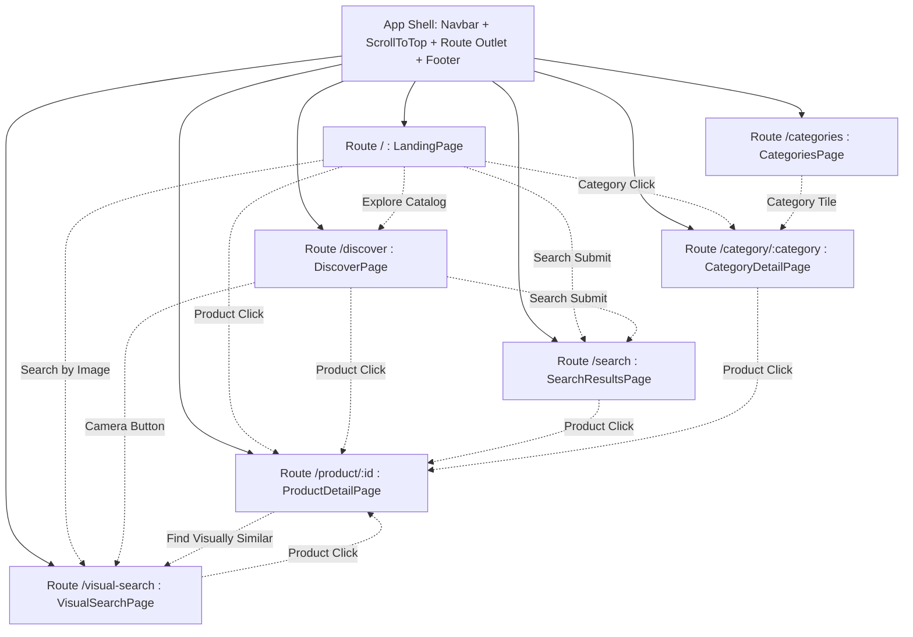

# FRONTEND ARCHITECTURE & MULTI-PAGE APPLICATION SYSTEM

```text
STATUS: PRODUCTION MULTI-PAGE APPLICATION (IMPLEMENTED & VERIFIED)
Framework: React 18+ / React Router v7 / Vite / TypeScript (strict mode)
Styling: Tailwind CSS / Heroicons & Lucide Icons
Design Direction: Full-Width Responsive Commercial Discovery Platform
```

---

## 1. Directory Structure

```text
frontend/
├── public/
├── src/
│   ├── assets/
│   ├── components/
│   │   ├── common/
│   │   │   ├── Badge.tsx               # Subtle visual match badge & discount chips
│   │   │   ├── EmptyState.tsx          # Clean editorial empty state with recovery action
│   │   │   ├── Footer.tsx              # Persistent minimal footer (Product, Categories, Legal)
│   │   │   ├── Navbar.tsx              # Persistent application shell navigation with search & links
│   │   │   ├── ScrollToTop.tsx         # Route change scroll reset helper
│   │   │   └── Skeleton.tsx            # Subtle neutral skeleton loading placeholders
│   │   ├── landing/
│   │   │   ├── HeroSection.tsx         # Headline, prominent search, image upload CTA, concept visual
│   │   │   ├── DiscoveryMethodsSection.tsx # Editorial 3-pillar layout (Search, Filter, Visual Search)
│   │   │   ├── VisualSearchShowcaseSection.tsx # Signature capability showcase with live preview
│   │   │   ├── HowItWorksSection.tsx   # 3-step typographic process (01, 02, 03)
│   │   │   ├── CategoryDiscoverySection.tsx # Real photography category cards with item counts
│   │   │   ├── FeaturedProductsSection.tsx # Curated 4-column product grid with direct modal triggers
│   │   │   ├── TrustSection.tsx        # Transparent engineering capabilities (no fake metrics)
│   │   │   └── FinalCtaSection.tsx     # Clean call-to-action with whitespace
│   │   ├── search/
│   │   │   ├── ActiveFilters.tsx       # Breadcrumbs, active filter chips, count, sort
│   │   │   └── FilterSidebar.tsx       # Compact categories, price slider, brands, tags
│   │   ├── product/
│   │   │   ├── ProductCard.tsx         # Unified 4:5 card with routing and visual match breakdown
│   │   │   ├── ProductGrid.tsx         # Responsive grid (4 col desktop, 3 col tablet, 2 col mobile)
│   │   │   ├── ProductDetailModal.tsx  # Quick preview modal
│   │   │   └── SimilarProducts.tsx     # Reusable visually similar products shelf
│   │   └── visual-search/
│   │       └── VisualSearchModal.tsx   # Quick visual search trigger modal
│   ├── pages/
│   │   ├── LandingPage.tsx             # Route / (Marketing & Discovery Entry Point)
│   │   ├── DiscoverPage.tsx            # Route /discover (Main Application Catalog Homepage)
│   │   ├── SearchResultsPage.tsx       # Route /search (Search Results with URL Query State)
│   │   ├── VisualSearchPage.tsx        # Route /visual-search (Dedicated Application Workflow)
│   │   ├── CategoriesPage.tsx          # Route /categories (Full Catalog Taxonomy)
│   │   ├── CategoryDetailPage.tsx      # Route /category/:category (Department Collection)
│   │   └── ProductDetailPage.tsx       # Route /product/:id (Full-Width Product Details)
│   ├── services/
│   │   └── api.ts                      # Type-safe REST client for backend
│   ├── types/
│   │   ├── product.ts                  # TypeScript interfaces for catalog
│   │   └── visualSearch.ts             # Interfaces for visual search pipeline
│   ├── App.tsx                         # Router configuration & persistent application shell
│   ├── index.css                       # Editorial base theme, typography & scrollbar styles
│   └── main.tsx
├── index.html
├── package.json                        # Includes react-router-dom
├── tailwind.config.js                  # Warm neutral palette, disciplined 4-12px radii
├── tsconfig.json
└── vite.config.ts
```

---

## 2. Route Architecture & Flow



---

## 3. URL State Synchronization

1. `/search`:
   - Query string: `?q=...&category_id=...&brand_id=...&min_price=...&max_price=...&tags=...&sort_by=...&page=...`
   - Back/Forward buttons and page refreshes maintain exact catalog filter state.
2. `/visual-search`:
   - Query string: `?image=${url}&name=${title}` seeds the visual search engine with any catalog item.
3. `/category/:category`:
   - Department slug directly in the path (e.g. `/category/footwear`, `/category/outerwear-apparel`).
4. `/product/:id`:
   - UUID path parameter directly loads full product specifications and similar items.
