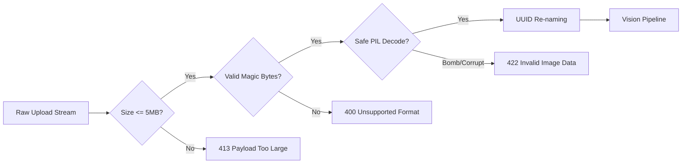

# SECURITY & DATA INTEGRITY SPECIFICATION

```text
STATUS: SPECIFIED & HARDENED
Phase: First-Round Prototype
Compliance: OWASP Top 10 Web Application Security
```

---

## 1. File Upload Security Policy

Uploaded images are treated as untrusted, hostile input. Every upload must pass through the four-stage validation filter before being processed or persisted.



### 1.1 Validation Controls
1. **Payload Limit:** Maximum allowed file size is 5 MB (`5 * 1024 * 1024` bytes).
2. **Magic Byte Verification:** The backend inspects the leading bytes of the raw payload, refusing to trust the client's `Content-Type` header:
   - JPEG: `FF D8 FF`
   - PNG: `89 50 4E 47 0D 0A 1A 0A`
   - WEBP: `52 49 46 46` (RIFF) ... `57 45 42 50` (WEBP)
3. **Decompression Bomb Defense:** PIL's `MAX_IMAGE_PIXELS` is capped at `10,000,000` (10 megapixels) to neutralize pixel-flood DoS exploits.
4. **Filename Sanitization:** The original client filename is never used in storage or disk operations. All files are mapped to `uuid.uuid4().hex` with verified safe extensions (`.jpg`, `.png`, `.webp`).
5. **Path Traversal Protection:** Absolute paths, `../`, and non-alphanumeric characters in form metadata are stripped.

---

## 2. API Security & Input Validation

- **Pydantic v2 Schema Enforcement:** Every query parameter, path variable, and request body is strictly type-checked and validated (e.g. `min_price >= 0`, `page >= 1`, UUID format validation).
- **CORS Configuration:** Configurable origin allow-list (`http://localhost:5173`, `http://127.0.0.1:5173`, and production domains). Wildcard `*` with credentials is explicitly forbidden.
- **Rate Limiting:** Global rate limit middleware in place to prevent brute-force querying and abuse of vision feature extraction endpoints.

---

## 3. Database & Storage Security

- **Parameterized Queries:** All database interactions use Supabase client / PostgreSQL prepared statements, preventing SQL injection.
- **Row Level Security (RLS) Architecture:**
  - **Browser / Client Layer:** Restricted strictly to `SELECT` operations using the public Supabase `anon` key.
  - **Public Write Prohibition:** No public or anonymous `INSERT`, `UPDATE`, or `DELETE` policies exist. Mutating operations attempted with public keys are rejected by PostgreSQL RLS.
  - **Backend Ingestion Layer:** Privileged synchronization runs via backend `SUPABASE_SERVICE_ROLE_KEY`, which bypasses RLS safely within server-side scripts only.
- **Credential Isolation:**
  - Service-role secrets and external API credentials (e.g. eBay client secrets) reside strictly in `backend/.env`.
  - The frontend client bundle contains zero database secret keys, service roles, or provider credentials.
- **Error Information Leakage Prevention:** Stack traces and internal database schema names are suppressed in production mode. Standardized JSON error envelopes (`error`, `message`, `code`) are returned.
