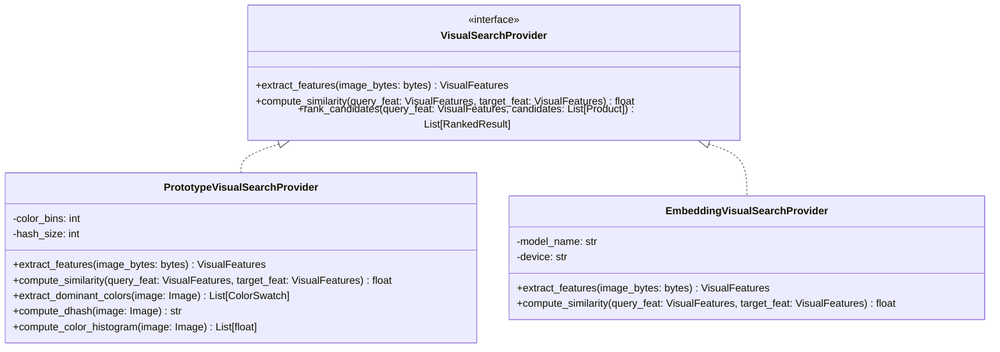

# VISUAL SEARCH SPECIFICATION & ALGORITHM DESIGN

```text
STATUS: SPECIFIED & PROVIDER ABSTRACTION DEFINED
Current Provider: PrototypeVisualSearchProvider
Target Provider: EmbeddingVisualSearchProvider (CLIP + pgvector)
Strict Invariant: ZERO hardcoded file-based or name-based logic
```

---

## 1. Provider Pattern Architecture

The visual search engine is abstracted through an interface pattern so the underlying vision algorithm can be upgraded with zero changes to routes, services, or frontend components.



---

## 2. Prototype Provider Algorithmic Design

The `PrototypeVisualSearchProvider` computes real mathematical similarity on every uploaded image using three complementary computer-vision signals:

### 2.1 Color Distribution Matching ($S_{\text{color}}$)
- Image is converted to HSV (Hue, Saturation, Value) color space to achieve illumination invariance.
- A 32-bin normalized color histogram is calculated.
- Color similarity between query image $Q$ and candidate product image $P$ is computed using **Bhattacharyya Distance / Histogram Intersection**:
  $$S_{\text{color}}(Q, P) = \sum_{i=1}^{N} \min(H_Q[i], H_P[i])$$

### 2.2 Structural / Geometry Matching ($S_{\text{structure}}$)
- 64-bit Difference Hash (dHash) computed:
  1. Downsample image to $9 \times 8$ grayscale.
  2. Compute gradient between adjacent horizontal pixels ($P_{x, y} > P_{x+1, y}$).
  3. Output 64-bit binary sequence.
- Structural similarity is derived from normalized Hamming distance:
  $$S_{\text{structure}}(Q, P) = 1.0 - \frac{\text{HammingDistance}(\text{dHash}_Q, \text{dHash}_P)}{64}$$

### 2.3 Semantic Visual Attribute Overlap ($S_{\text{tags}}$)
- Extracted high-salience visual attributes (e.g., color families, silhouette type, materials) are scored against catalog visual tags using **Weighted Jaccard Index**:
  $$S_{\text{tags}}(Q, P) = \frac{|T_Q \cap T_P|}{|T_Q \cup T_P|}$$

### 2.4 Composite Similarity Score ($S_{\text{total}}$)
The final similarity score is a weighted linear combination:
$$S_{\text{total}} = (w_c \cdot S_{\text{color}}) + (w_s \cdot S_{\text{structure}}) + (w_t \cdot S_{\text{tags}})$$
Default calibrated weights:
- $w_c = 0.40$ (Color & Palette)
- $w_s = 0.35$ (Shape & Edge Geometry)
- $w_t = 0.25$ (Attributes & Materials)

Resulting score is bounded strictly between `0.00` and `1.00`.

---

## 3. Fallback Mechanism & Thresholding

- **Confidence Threshold:** If the highest candidate score is below `0.35`, the engine activates graceful fallback:
  1. Sets `fallback_used = True` in the response payload.
  2. Returns top-rated / trending products from the most probable detected category.
  3. Returns a user-friendly notice for UI display: *"No close visual match found. Showing popular items in category."*
- **Fail-Safe Operation:** If the vision library fails or an unreadable byte sequence is encountered, the endpoint catches the exception gracefully, logs developer diagnostics, and serves the standard catalog with a non-blocking notification.
